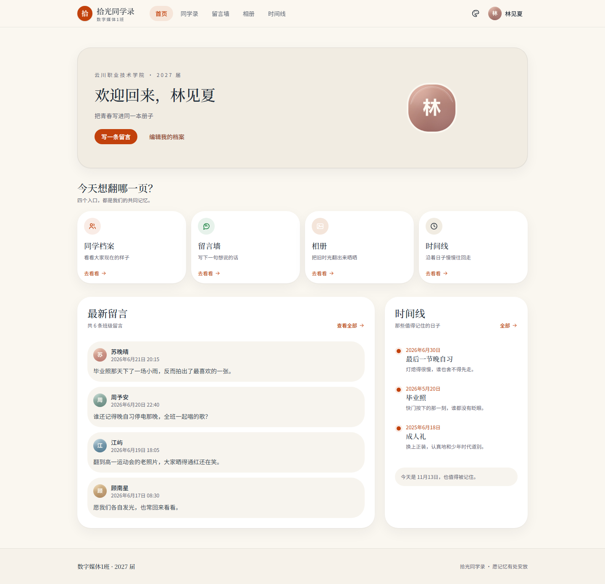
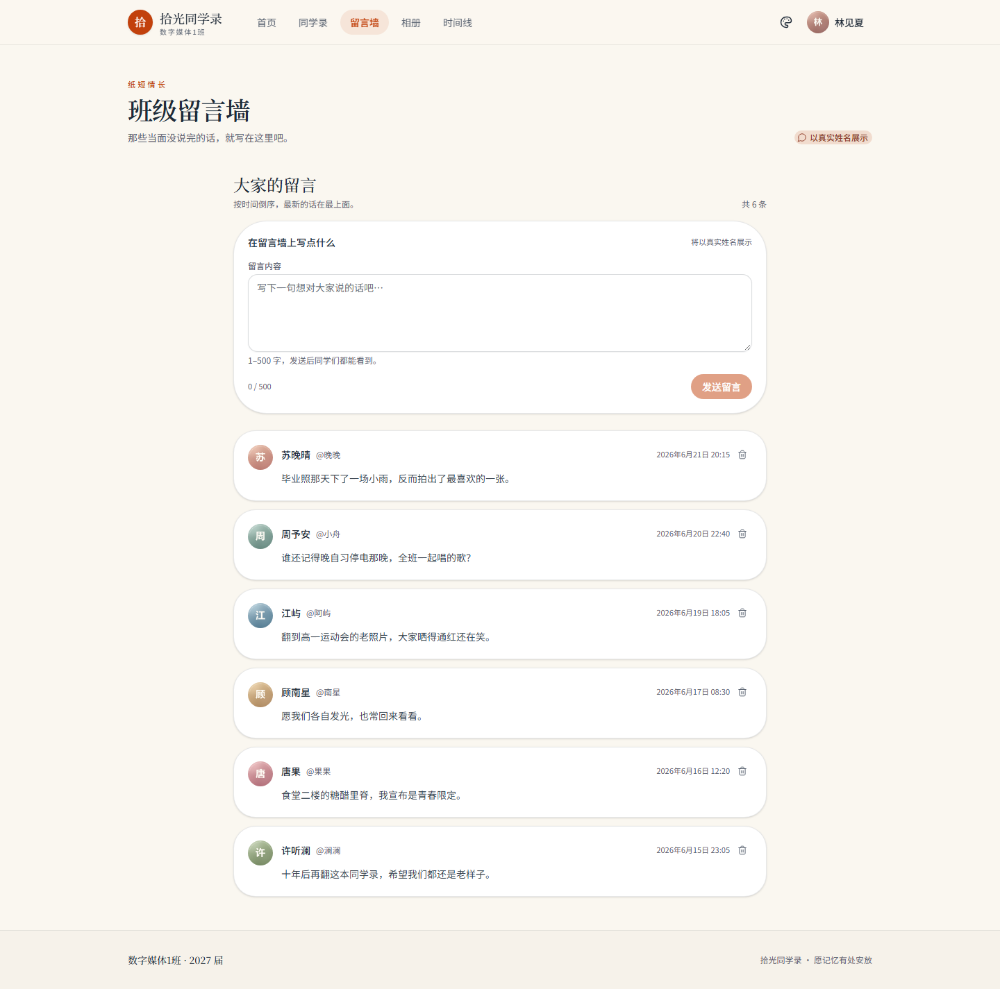
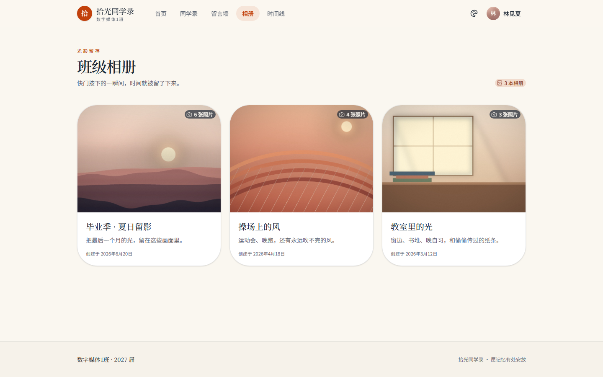
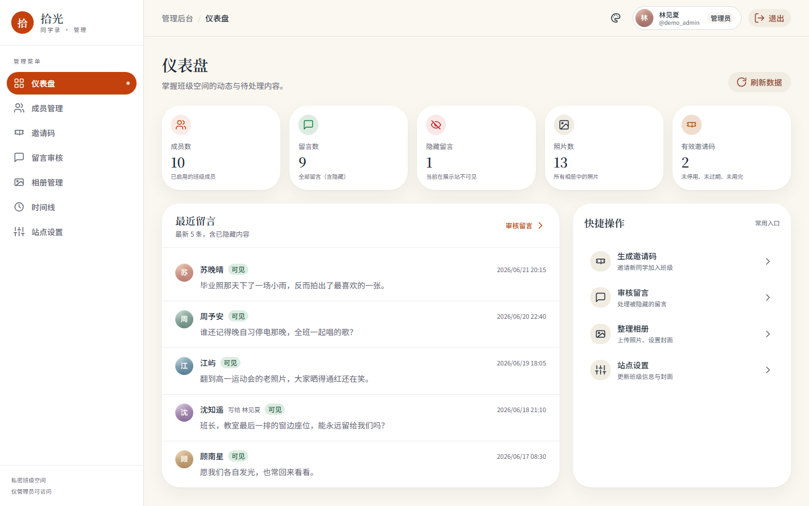

# 拾光同学录 · Classbook

一本可以部署在公网、只属于自己班级的同学录。记录同窗档案、留言、相册与班级时间线，支持邀请码注册、内容审核和站点主题。

[](https://github.com/Self-Command/classbook/actions/workflows/ci.yml)
[](https://github.com/Self-Command/classbook/actions/workflows/docker.yml)
[](https://github.com/Self-Command/classbook/pkgs/container/classbook-api)
[](https://github.com/Self-Command/classbook/pkgs/container/classbook-web)

> 截图中的姓名、头像、留言、照片均为虚构演示数据，不包含任何真实个人信息。

## 预览

| 前台首页 | 留言墙 |
| --- | --- |
|  |  |

| 班级相册 | 管理后台 |
| --- | --- |
|  |  |

更多页面截图：[公开首页](docs/screenshots/public-landing.png)、[同学录](docs/screenshots/classmates.png)、[同学详情](docs/screenshots/classmate-detail.png)、[相册详情](docs/screenshots/album-detail.png)、[时间线](docs/screenshots/timeline.png)、[我的档案](docs/screenshots/me.png)、[管理后台成员](docs/screenshots/admin-members.png)、[邀请码](docs/screenshots/admin-invites.png)、[留言审核](docs/screenshots/admin-messages.png)、[站点设置](docs/screenshots/admin-settings.png)。

## 功能

- **班级空间**：站点名称、学校、毕业年份、标语与封面图可配置。
- **同学录**：成员档案、头像、寄语、联系方式、个人留言板。
- **留言墙**：发布、删除、管理员审核与隐藏，支持定向留言。
- **相册**：多相册、照片上传、封面、说明与灯箱浏览。
- **时间线**：按年份整理班级大事记，支持图片。
- **邀请码注册**：有效期、使用次数、启用/停用，注册即入班。
- **管理后台**：仪表盘、成员、邀请码、留言、相册、时间线、站点设置。
- **主题系统**：暖阳、森林、海洋、夜航等原生主题，支持系统偏好与本地记忆。
- **光标特效**：全站 Swarm 协作光标动画，支持音量开关与滑杆调节，首次交互后解锁音效。
- **响应式**：桌面、平板与手机布局，移动端无横向滚动。
- **安全**：HttpOnly Cookie、同源部署、管理员鉴权、上传类型/大小限制。

## 架构

```text
                    HTTPS
Browser ──────────────────────▶ 宿主机 Nginx
                                    │ 127.0.0.1:8080
                                    ▼
                           ┌─────────────────┐
                           │   web 容器      │
                           │  Nginx          │
                           │  /  → Web SPA   │
                           │  /admin/ → Admin│
                           │  /api/ ─────────┼──▶ api 容器 :3000
                           │  /uploads/ ─────┼──▶ api 容器 :3000
                           └─────────────────┘         │
                                                       ▼
                                              postgres:16-alpine
                                              pgdata volume
```

- Web 与 Admin 在同一个 `web` 容器内由 Nginx 托管，天然同源，Cookie 可共用。
- API 与 PostgreSQL 不对宿主机暴露端口，只在 Compose 内部网络通信。
- 生产镜像由 GitHub Actions 构建并推送到 GHCR，服务器只拉取镜像。
- 上传文件与数据库分别持久化在 `uploads`、`pgdata` volume。

## 技术栈

| 层 | 技术 |
| --- | --- |
| 包管理 | pnpm 12 workspace |
| 运行时 | Node.js 24 |
| 前端 | React 19、Vite 7、TypeScript 5.9、Tailwind CSS 4、HeroUI 3 |
| 后端 | Express 5、Prisma 6、PostgreSQL 16、Zod、JWT、bcryptjs、multer |
| 测试 | Vitest、Supertest、Node Test |
| 部署 | Docker Compose、Nginx、GitHub Actions、GHCR |

## 目录

```text
apps/
  api/          Express API、Prisma schema/migrations/seed
  web/          React 展示站
  admin/        React 管理后台（base /admin/）
packages/
  shared/       共享类型、Zod schema、常量
deploy/
  Dockerfile.api
  Dockerfile.web
  docker-compose.yml
  nginx.web.conf
  nginx.conf.example
  .env.example
docs/           设计、接口、主题、Swarm、部署与截图
```

## 本地开发

要求：Node.js 24、pnpm 12、Docker（可选，用于本地 PostgreSQL）。

```bash
pnpm install

# 准备 API 环境变量
cp .env.example apps/api/.env
# 编辑 apps/api/.env，至少设置 ADMIN_PASSWORD

# 启动本地嵌入式 PostgreSQL（127.0.0.1:5433）
pnpm db:start

# 建表并创建管理员
pnpm db:migrate
ADMIN_PASSWORD="your-strong-password" pnpm db:seed

# 同时启动 API / Web / Admin
pnpm dev
```

| 服务 | 地址 |
| --- | --- |
| Web | http://127.0.0.1:5173 |
| Admin | http://127.0.0.1:5174/admin/ |
| API | http://127.0.0.1:3000/api/health |
| PostgreSQL | 127.0.0.1:5433 |

停止本地数据库：

```bash
pnpm db:stop
```

## 演示数据

仓库自带 `apps/api/prisma/demo-images/`，可以生成一套完全虚构的班级数据，用于本地预览或截图。

先启动 API，并确保管理员已创建：

```bash
CONFIRM_DEMO_SEED=yes \
ADMIN_PASSWORD="your-admin-password" \
DEMO_API_URL="http://127.0.0.1:3000" \
pnpm db:seed:demo
```

演示数据会清空除管理员外的业务数据，并创建 9 位虚构同学、留言、相册、时间线和邀请码。默认成员密码为 `Demo-Member-2026!`，可用 `DEMO_MEMBER_PASSWORD` 覆盖。

## Docker 部署

生产部署的完整步骤见 [docs/deployment.md](docs/deployment.md)。最短流程：

```bash
git clone https://github.com/Self-Command/classbook.git /opt/classbook
cd /opt/classbook
cp deploy/.env.example deploy/.env
# 填写 deploy/.env 中的域名、密码和密钥

docker compose -f deploy/docker-compose.yml --env-file deploy/.env pull
docker compose -f deploy/docker-compose.yml --env-file deploy/.env up -d

# 仅首次：创建管理员
docker compose -f deploy/docker-compose.yml --env-file deploy/.env \
  exec -T api pnpm --filter @classbook/api db:seed
```

然后按 [deploy/nginx.conf.example](deploy/nginx.conf.example) 配置宿主机 Nginx，并用 certbot 签发 HTTPS。

### 镜像

| 镜像 | 地址 |
| --- | --- |
| API | `ghcr.io/self-command/classbook-api:latest` |
| Web | `ghcr.io/self-command/classbook-web:latest` |

`main` 分支推送后自动构建 `latest` 与 `sha-<commit>`；推送 `v*` 标签会额外生成版本标签。GHCR 包需要在仓库的 Package settings 中设为 **Public**，服务器才能匿名拉取。

如果暂时是 Private：

```bash
echo "<PAT-with-read:packages>" | docker login ghcr.io -u <github-user> --password-stdin
```

## 环境变量

### 本地（`apps/api/.env`）

| 变量 | 必填 | 说明 |
| --- | --- | --- |
| `DATABASE_URL` | 是 | PostgreSQL 连接串 |
| `JWT_SECRET` | 生产必填 | JWT 签名密钥 |
| `ADMIN_USERNAME` | 否 | 初始管理员用户名，默认 `admin` |
| `ADMIN_PASSWORD` | seed 必填 | 初始管理员密码 |
| `UPLOAD_DIR` | 否 | 上传目录，默认 `./uploads` |
| `COOKIE_SECURE` | 否 | 生产 HTTPS 设为 `true` |
| `WEB_ORIGIN` / `ADMIN_ORIGIN` | 否 | 允许的前端来源 |

### Docker（`deploy/.env`）

| 变量 | 说明 |
| --- | --- |
| `IMAGE_PREFIX` | 镜像前缀，默认 `ghcr.io/self-command` |
| `IMAGE_TAG` | `latest` 或 `sha-xxxxxxx` |
| `WEB_PORT` | 宿主机回环端口，默认 `8080` |
| `POSTGRES_USER` / `POSTGRES_PASSWORD` / `POSTGRES_DB` | 数据库凭据，密码需 URL 安全 |
| `JWT_SECRET` | 随机长字符串，`openssl rand -hex 32` |
| `ADMIN_USERNAME` / `ADMIN_PASSWORD` | 首次 seed 管理员 |
| `COOKIE_SECURE` | 生产保持 `true` |
| `PUBLIC_ORIGIN` | 站点完整域名，如 `https://classbook.example.com` |
| `TZ` | 时区，默认 `Asia/Shanghai` |

## 常用脚本

| 命令 | 说明 |
| --- | --- |
| `pnpm dev` | 并行启动 API/Web/Admin |
| `pnpm typecheck` | 全部 TypeScript 类型检查 |
| `pnpm build` | 构建 Web/Admin，并检查 API 类型 |
| `pnpm test` | API Vitest 测试 |
| `pnpm db:start` / `db:stop` | 本地 PostgreSQL 启停 |
| `pnpm db:migrate` | 开发迁移 |
| `pnpm db:seed` | 创建管理员与默认站点设置 |
| `pnpm db:seed:demo` | 生成虚构演示数据（危险，需显式确认） |
| `pnpm --filter @classbook/web test:audio` | Swarm 音量逻辑 Node 测试 |

## 测试

```bash
pnpm typecheck
pnpm test
pnpm build
```

API 测试需要 `classbook_test` 数据库。CI 使用 PostgreSQL 16 服务容器并自动执行迁移；本地可复用 `pnpm db:start` 创建的实例。

Swarm 光标与音效的浏览器验证脚本位于 `.dev/verify-swarm.mjs`（本地开发辅助，不参与构建）。

## 文档

- [生产部署](docs/deployment.md)
- [设计文档](docs/design.md)
- [API 契约](docs/api-contract.md)
- [主题系统](docs/theme-system.md)
- [Swarm 光标集成](docs/swarm-integration.md)
- [页面截图](docs/screenshots/)

## 安全说明

- 生产只暴露 80/443，`8080` 仅绑定 `127.0.0.1`，API/数据库不发布端口。
- 登录态使用 HttpOnly Cookie，生产启用 `Secure` 与 `SameSite=Lax`。
- 上传仅允许 JPG/PNG/WebP，限制大小并随机化文件名；`/uploads` 需要登录。
- 管理员接口统一鉴权，管理员不能禁用或降级自己。
- 不要提交 `deploy/.env`、`apps/api/.env` 或任何真实班级数据。
- 上线后请立即修改初始管理员密码。

## License

[MIT](LICENSE)
